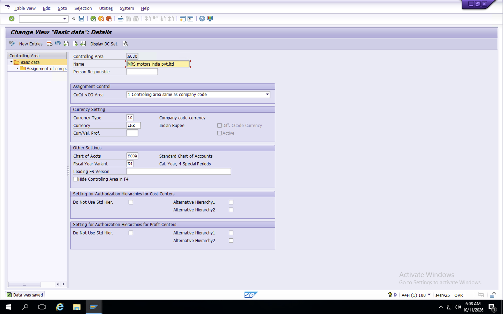
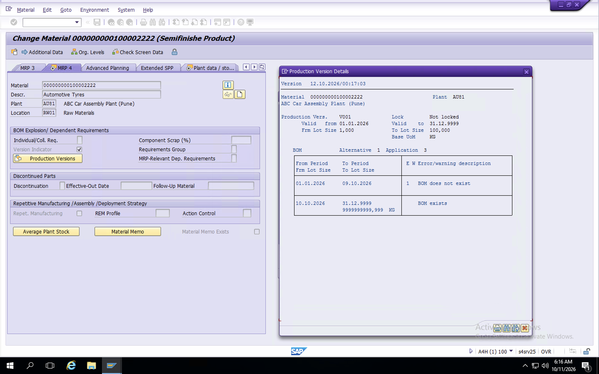
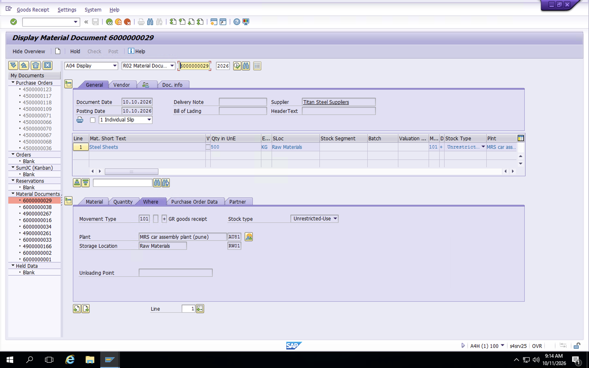
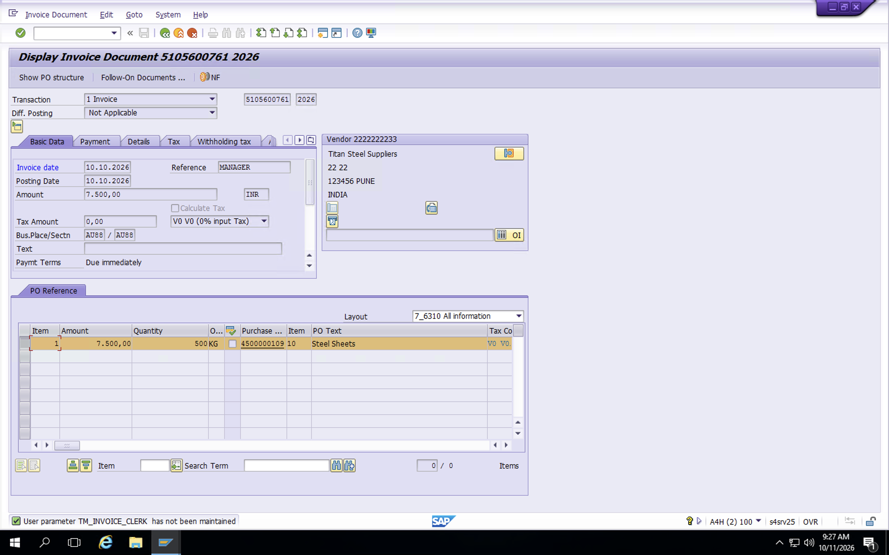
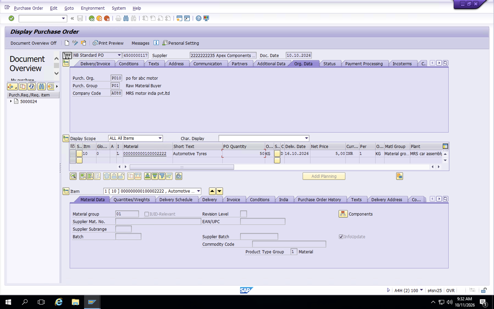
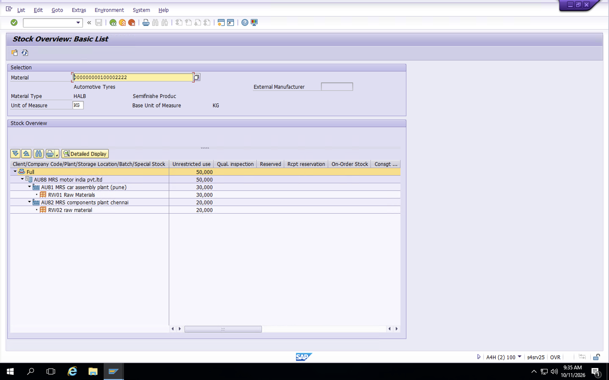
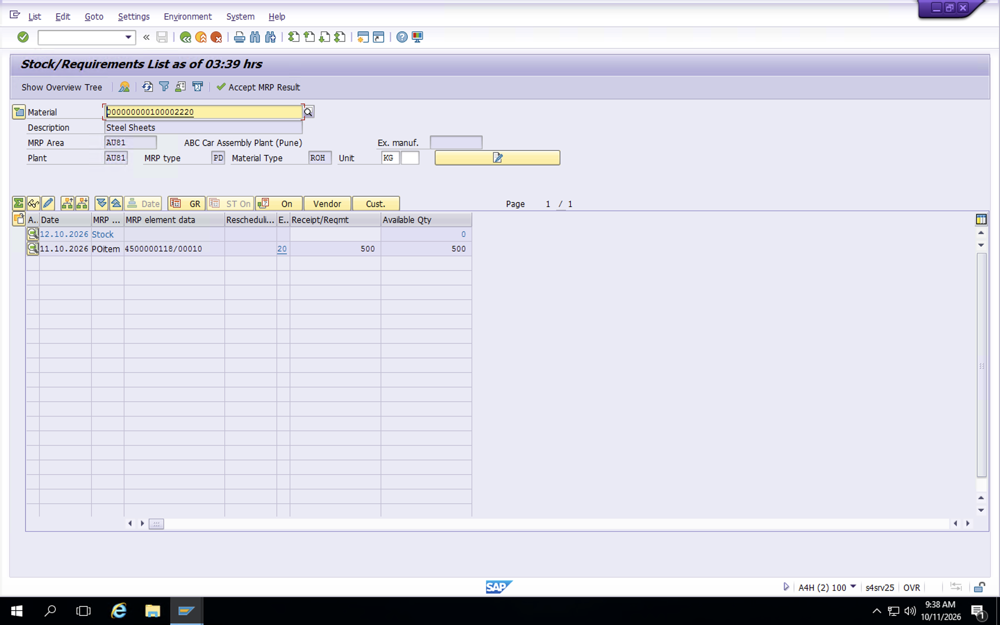

# SAP S/4HANA Materials Management (MM) Implementation
**Enterprise Blueprint & Automation Portfolio** | **Client Case Study:** MRS Motors India Pvt. Ltd.

An end-to-end, streamlined functional implementation of the SAP S/4HANA Materials Management module. This project details the enterprise architecture configuration, core procurement tracks, and inventory automation cycles executed within a multi-plant automotive manufacturing environment.

---

## 🏢 1. Enterprise Structure & Master Data

### Enterprise Blueprint Configuration
* **Company Code:** `AU88` (MRS Motors Finance)
* **Plant 1:** `AU81` (Car Assembly Plant - Pune)
* **Plant 2:** `AU82` (Components Plant - Mumbai)
* **Purchasing Organization & Group:** `AU88`
* **Controlling Assignment:** Assigned Company Code `AU88` to Controlling Area `AU88` and activated indicators for Fiscal Year 2026.

### Core Master Data Records
* **Raw Materials (ROH):** Steel Sheets (`100002220`), Aluminium Ingots (`100002221`)
* **Semi-Finished Components (HALB):** Automotive Tyres (`100002222`)
* **Consumables (HIBE):** Engine Lubricant Oil (`100002224`)
* **Suppliers Setup:** Established separate Business Partners (BP Roles: `FLVN00` / `FLVN01`) mapped to automated G/L Trade Payables.

---

## 🔄 2. End-to-End Core Procurement Process Flow
Below is the sequential transaction execution cycle tracking a single production raw material batch through the standard purchasing lifecycle:

### `PR (ME51N)` ➔ `PO (ME21N)` ➔ `GR (MIGO)` ➔ `Invoice (MIRO)` ➔ `Stock View (MMBE/MD04)`

### Phase 1: Internal Request & Contract Sourcing
1. **Purchase Requisition `[ME51N]`**: Logged internal factory demand for 500 KG of raw input components (PR: `0005000024`).
2. **Request for Quotation `[ME41 / ME49]`**: Issued inquiries to both regular vendors (RFQ: `6000000027`). Executed an automated price comparison matrix report to select the optimal bid (15 RS vs 18 RS) and flagged the losing quote with a formal Rejection Indicator.
3. **Purchase Order `[ME21N]`**: Generated the legal supply contract with reference to the winning RFQ layout (PO: `450000109`).

### Phase 2: Logistics & Valuation Fulfillment
4. **Goods Receipt `[MIGO - Movement Type 101]`**: Logged physical arrival at the factory gates to move the materials cleanly into warehouse storage (Material Doc: `6000029`).
5. **Invoice Verification `[MIRO]`**: Processed the incoming supplier invoice to balance out a formal Three-Way Match against the contract values (Invoice Doc: `5105600761`).
6. **Stock Requirements Evaluation `[MMBE / MD04]`**: Audited the live material ledger sheets to verify unrestricted inventory access balances.

---

## 🖼️ 3. Live System Execution Evidence
*Below is the verified screenshot evidence pulled from the live SAP S/4HANA system database, demonstrating successful system behavior at every critical milestone:*

### Enterprise Structure Setup

### Material Master Production Version Configuration (`MM02`)

### Business Partner Supplier Setup (`BP`)

### Purchase Requisition Screen (`ME53N`)

### Price Comparison Matrix Matrix (`ME49`)

### Purchase Order Contract Screen (`ME23N`)

### Warehouse Goods Receipt Logistics Ledger (`MIGO`)

### Invoice Verification Posting (`MIR4`)

### Subcontracting Contract Setup View (`ME23N`)

### Live Stock Overview Cross-Plant Tree (`MMBE`)

### Live Stock/Requirements Planning Ledger (`MD04 View`)

---

## 🛠️ 4. Project Issues & Functional Fixes Log
*Key cross-module hurdles encountered during system deployment and the backend configuration paths used to resolve them (Critical Interview Insights):*

#### Error 1: Controlling Area does not exist for Company Code AU88
* **Root Cause:** S/4HANA Logistics actions require immediate financial validation, but the newly generated custom company code was completely unmapped in the management accounting ledger tables.
* **Resolution Path:** Navigated to backend transaction code **`OX19`** (Assign Company Code to Controlling Area), mapped company code `AU88` to standard controlling area node `AU88`, and accessed **`OKKP`** to explicitly activate cost center management components for Fiscal Year 2026.

#### Error 2: OBYC Account Determination - Valuation Group/Class 3000 Blank Account
* **Root Cause:** When running a Goods Receipt (`MIGO`), the logistics sub-ledger failed to pass stock value updates because it could not identify the proper destination General Ledger (G/L) accounts.
* **Resolution Path:** Launched integration transaction code **`OBYC`**, accessed transaction keys **`BSX`** (Inventory Postings) and **`WRX`** (GR/IR Clearing), and mapped Valuation Class **`3000`** directly to the active standard asset accounts (`16000000` and `16059000`) under Chart of Accounts `YCOA`.

#### Error 3: Subcontracting PO - Not possible to determine any components
* **Root Cause:** When attempting an outsourced purchase order using item category `L`, the system failed to trigger the raw component requirement explosion because no active production variant pathway existed on S/4HANA.
* **Resolution Path:** Extended the master material record views to include **MRP 4** using transaction **`MM01`**, navigated to the **Production Version** sub-screen, created variant version `V001`, and mapped it directly to the alternative Bill of Material (`BOM 1`) under usage code 1.
